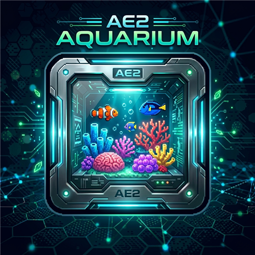

# AE2 Aquarium

<div align="center">
  

  **3D Multiblock Coral & Reef Cultivation inside your ME Network for Minecraft 1.21.1 (NeoForge)**

  [](https://minecraft.net/)
  [](https://neoforged.net/)
  [](https://appliedenergistics.org/)
  [](LICENSE)
</div>

---

## 🐠 About

**AE2 Aquarium** is an official-style companion addon in the **AE2 Virtual** series for **Applied Energistics 2** on **Minecraft 1.21.1 (NeoForge)**. Because vanilla Minecraft provides no renewable way to cultivate **Coral Blocks**, and building massive aquatic farms can cause heavy entity and water-tick lag, **AE2 Aquarium** introduces a scalable, fully 3D-animated **ME Reef Aquarium Multiblock**.

Build a panoramic glass aquarium of any size from **3×3×3 up to 16×8×16**, insert a standard **ME Item Storage Cell (`1k`–`256k`)** directly into the **ME Aquarium Tank Controller**, configure up to **5 Coral or Marine Specimens**, and watch a living coral reef with animated tropical fish, swaying corals, and rising bubbles cultivate coral blocks, fans, polyps, sea lanterns, sponges, and ocean treasures directly into the controller's internal storage cell!

---

## ✨ Features

- 🏛️ **Scalable 3D Panoramic Multiblock (`3×3×3` to `16×8×16`):**
  - Dynamically forms from a single **ME Aquarium Tank Controller**, **Aquarium Structural Casings** along the frame edges, and **Reinforced Aquarium Glass** across the walls and roof.
  - When formed, structural casings automatically morph into **ultra-slim 4px bottom pedestals, 3px top LED canopies, and sleek corner pillars**, giving you a nearly borderless panoramic view of your underwater reef!
- 🎨 **Fully Animated 3D Reef Ecosystem (Custom BER):**
  - Renders a sandy seabed, glowing water volume, rising air bubbles, and **living 3D coral colonies** that dynamically match the exact specimens configured in your controller.
  - Procedurally animated **3D tropical fish schools** swim along figure-8 paths with tail-fin oscillation, banking turns, and quantity/size that scale with your tank's interior volume.
- 💾 **Dedicated Internal ME Storage Cell (Zero Network Flooding):**
  - Insert any standard **AE2 Item Storage Cell (`1k`, `4k`, `16k`, `64k`, or `256k`)** directly into the controller's **Storage Cell Slot**.
  - The controller mounts its internal cell onto your ME Network via `IStorageProvider` as **read/extract-only**—all items are immediately visible and extractable in ME Terminals, Export Buses, and Autocrafting, while external network items can never be dumped into your aquarium cell.
  - Generated drops are stored **strictly inside the controller's cell** and **never** spill over into your external ME Drives!
  - When the cell (or an individual partition's byte allocation) is full, production automatically pauses with **zero wasted AE power**.
- 📊 **GParted-Style Habitat Allocation Bar:**
  - Configure up to **5 simultaneous Coral/Marine Specimens** per aquarium.
  - Use the interactive **Habitat Allocation Bar** (`-5%` / `+5%` and `Equalize`) to divide both the **drop output** and the **internal storage cell byte capacity** across your active specimens.
  - Even if one coral type reaches its allocated byte cap inside the cell, your other configured specimens continue producing up to their own share!
- 🪸 **Complete Coral & Marine Resource Coverage Out of the Box:**
  - **All 5 Coral Families (Tube, Brain, Bubble, Fire, Horn):** Produces full **Coral Blocks** (60%), **Coral Plants** (16%), **Coral Fans** (14%), plus **Dead Coral Blocks / Plants / Fans** (10% total).
  - **Reef Flora & Illumination:** **Sea Pickles**, **Kelp**, **Seagrass**, **Glow Lichen**, **Prismarine**, **Dark Prismarine**, and **Sea Lanterns**.
  - **Deep Ocean Treasures:** **Wet & Dry Sponges**, **Nautilus Shells**, **Turtle Scutes**, and **Heart of the Sea** (yields Nautilus Shells, Prismarine Crystals/Shards, Diamond, and rare Heart of the Sea).
  - **Automatic Modded Coral Discovery:** Automatically discovers modded coral and marine blocks via `#minecraft:corals`, `#minecraft:coral_blocks`, `#minecraft:coral_plants`, and `#minecraft:wall_corals`.
- ⚡ **AE2 Upgrade Card Support (2 Upgrade Slots):**
  - **Acceleration Card (up to 2x):** Multiplies drop yield per cycle (`1 Card = 2x`, `2 Cards = 4x`).
  - **Inverter Card:** Inverts coral cultivation to produce **100% Dead Coral Blocks, Dead Coral Plants, and Dead Coral Fans**—ideal for building palettes!
  - **Void Secondary Card:** Automatically voids secondary byproducts (such as Dead Coral variants or Coral Fans) and saves their AE energy cost so your cell only fills with primary **Coral Blocks**.
- 🤝 **100% Compatible with the `AE2Virtual` Series:**
  - Works seamlessly alongside **AE2 Virtual Garden**, **AE2 Virtual Mine**, **AE2 Virtual Battle**, and **AE2 Virtual Well** without namespace, recipe, or storage conflicts.

---

## 📐 Multiblock Structure & Scaling

By default, generation cycles run every **60 ticks (3.0 seconds)** and scale directly with the **inner water volume** $(W - 2) \times (H - 2) \times (D - 2)$ of your aquarium:

| Outer Tank Size | Inner Water Volume | Base Drops / Cycle | With 1× Accel Card (2×) | With 2× Accel Cards (4×) | Idle Power Drain |
| :--- | :--- | :--- | :--- | :--- | :--- |
| **3×3×3 (Minimum)** | $1 \times 1 \times 1 = 1\text{ m}^3$ | **1 Drop / 3.0s** | 2 Drops / 3.0s | 4 Drops / 3.0s | 1.1 AE/t |
| **5×4×5 (Medium)** | $3 \times 2 \times 3 = 18\text{ m}^3$ | **18 Drops / 3.0s** | 36 Drops / 3.0s | 72 Drops / 3.0s | 2.8 AE/t |
| **7×5×7 (Large)** | $5 \times 3 \times 5 = 75\text{ m}^3$ | **75 Drops / 3.0s** | 150 Drops / 3.0s | 300 Drops / 3.0s | 8.5 AE/t |
| **11×6×11 (Grand Reef)** | $9 \times 4 \times 9 = 324\text{ m}^3$ | **324 Drops / 3.0s** | 648 Drops / 3.0s | 1,024 Drops / 3.0s | 33.4 AE/t |
| **16×8×16 (Max Leviathan)** | $14 \times 6 \times 14 = 1,176\text{ m}^3$ | **1,024 Drops / 3.0s** | 1,024 Drops / 3.0s | 1,024 Drops / 3.0s | 118.6 AE/t |

### How to Build the Multiblock
1. Build a hollow rectangular box of any outer size between **3×3×3** and **16×8×16**.
2. Place **exactly one ME Aquarium Tank Controller** on the **bottom outer perimeter** (not on a corner) facing outward.
3. Fill the remaining outer frame edges or floor with **Aquarium Structural Casings** and the side walls/roof with **Reinforced Aquarium Glass** (glass and casings can be freely mixed on the shell; keeping the walls and ceiling glass maximizes your 3D view).
4. Leave the **interior blocks completely empty (Air)**—as soon as the structure is valid, it automatically forms into a slim panoramic aquarium and fills with animated 3D water, coral reefs, and tropical fish!
5. Connect an ME Cable to the **ME Aquarium Tank Controller**, insert any standard **AE2 Item Storage Cell (`1k`–`256k`)**, and configure your coral specimens in the GUI or by **Sneak + Right-Clicking** the controller with a coral item in hand.

---

## 🔨 Crafting Recipes

### 1. Aquarium Structural Casing (4x)
```
[ Iron Ingot   ] [ Quartz Glass ] [ Iron Ingot   ]
[ Quartz Glass ] [ Kelp         ] [ Quartz Glass ]
[ Iron Ingot   ] [ Copper Ingot ] [ Iron Ingot   ]
```

### 2. Reinforced Aquarium Glass (4x)
```
[ Quartz Glass ] [ Prismarine Crystals ] [ Quartz Glass ]
[ Quartz Glass ] [ Aquarium Casing     ] [ Quartz Glass ]
[ Quartz Glass ] [ Quartz Glass        ] [ Quartz Glass ]
```
*(Wait—no Ocean Monument yet? An alternative early-game recipe lets you craft **2x Reinforced Aquarium Glass** using **Glow Ink Sac** or **Sea Pickle** instead of Prismarine Crystals!)*

### 3. ME Aquarium Tank Controller
```
[ Aquarium Casing      ] [ Engineering Processor ] [ Aquarium Casing      ]
[ Fluix Crystal        ] [ Heart of the Sea      ] [ Fluix Crystal        ]
[ Aquarium Casing      ] [ Logic Processor       ] [ Aquarium Casing      ]
```
*(Also supports an alternative recipe with **Calculation Processor + Water Bucket + Kelp** instead of Heart of the Sea for early progression!)*

### 4. Void Secondary Card (Shapeless)
- Combine **1x AE2 Basic Card** + **1x Cactus** + **1x Flint**.

---

## ⚙️ Configuration

The configuration file is located at `config/ae2aquarium-common.toml`:

```toml
[general]
  # Interval in world ticks between coral/marine drop generation cycles (20 ticks = 1 second, default 60 = 3 seconds)
  # Range: 5 ~ 72000
  baseTickInterval = 60

  # Whether generating drops requires AE energy from the ME Network
  requireAeEnergy = true

  # AE energy consumed per generated item drop
  # Range: 0.0 ~ 100000.0
  energyPerDrop = 12.0

  # Whether to automatically discover drops for unknown modded coral/aquatic blocks matching coral/marine tags.
  enableDynamicFallback = true

  # When true, players can only configure a specimen in the controller if they currently possess it in their inventory.
  enforceInventoryCheck = false

[multiblock]
  # Maximum outer dimensions of the 3D Aquarium multiblock (minimum is always 3)
  maxTankWidth = 16
  maxTankHeight = 8
  maxTankDepth = 16

  # Multiplier applied to the inner tank volume (in blocks^3) to determine generated drops per cycle
  volumeDropMultiplier = 1.0

  # Upper cap on drops per cycle for massive aquariums
  maxDropsPerCycle = 1024
```

---

## 📜 Custom Datapack Recipes

Modpack authors can add new marine specimens or customize coral drop tables using standard JSON datapack recipes in `data/<namespace>/recipe/<name>.json`:

```json
{
  "type": "ae2aquarium:aquarium_drop",
  "specimen": "minecraft:tube_coral_block",
  "drops": [
    {
      "item": "minecraft:tube_coral_block",
      "weight": 60,
      "min": 1,
      "max": 2
    },
    {
      "item": "minecraft:tube_coral",
      "weight": 16,
      "min": 1,
      "max": 2
    },
    {
      "item": "minecraft:tube_coral_fan",
      "weight": 14,
      "min": 1,
      "max": 2
    },
    {
      "item": "minecraft:dead_tube_coral_block",
      "weight": 10,
      "min": 1,
      "max": 1
    }
  ]
}
```

---

## 🛠️ Building From Source

1. Clone the repository:
   ```bash
   git clone https://github.com/GeneraBlack/AE2Aquarium.git
   cd AE2Aquarium
   ```
2. Build and run verification tests with Gradle:
   ```bash
   ./gradlew test build
   ```
3. The compiled mod JAR will be located in `build/libs/ae2aquarium-1.0.0.jar`.

---

## 📄 License

This project is licensed under the [MIT License](LICENSE). Feel free to include **AE2 Aquarium** in any public or private modpack!
